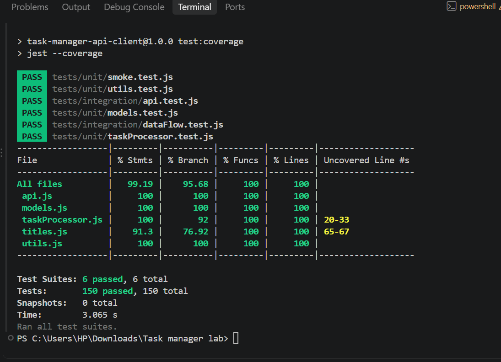

# Testing Documentation: Task Manager API Client

## How to run the tests

```
npm install
npm test               # run every Jest test once
npm run test:watch     # re-run tests when a file changes
npm run test:coverage  # run tests and write a coverage report to coverage/
npm run test:node      # the older node:test tests in test/ (kept from the first lab)
```

Jest only looks in the `tests/` folder. The project uses ES modules (`import`/`export`), so
Babel (`babel.config.cjs`) turns them into CommonJS for Jest.

## Testing Strategy

- **Most tests are small unit tests.** Each one checks one function or method with a small set of
  data made inside the test, so a failure points straight at the problem.
- **Integration tests check that the parts work together.** They use the real `APIClient` with a
  fake `fetch`, and run the real processing functions on data from a mock API.
- **Nothing uses the internet.** `fetch` is replaced with `jest.fn()`, and `tests/mocks/api.js`
  gives fixed users and todos. The tests give the same result every time, even offline.
- **Time is fixed.** Overdue logic and the made-up due dates depend on today's date, so every date
  test uses `jest.useFakeTimers()` and `jest.setSystemTime(15 October 2026)`.
- **Every test is independent.** `beforeEach()` builds fresh objects for each test, and
  `afterEach()` puts back the real timers, the real `fetch` and the real console. The mock API hands
  out a copy of its data on every call, so one test cannot change another test's data.
- **Bugs were fixed test-first.** When a test showed a bug, I wrote the failing test, watched it
  fail, fixed the code in its own `fix(...)` commit, and watched it pass.
- **The CLI file (`main.js`) is not unit tested.** It starts the interactive program as soon as it
  is loaded and reads from the keyboard, so it is left out of coverage. The steps it runs to load
  data are copied into `tests/integration/dataFlow.test.js` and tested there.

### Test files

| File | Type | Tests |
|---|---|---|
| `tests/unit/smoke.test.js` | Setup check: proves Jest runs and can load the ES modules | 1 (not counted below) |
| `tests/unit/models.test.js` | Unit | 45 (Task 13, PriorityTask 16, User 16) |
| `tests/unit/taskProcessor.test.js` | Unit | 47 |
| `tests/unit/utils.test.js` | Unit + spies | 32 (8 of them spy tests) |
| `tests/integration/api.test.js` | Integration | 18 |
| `tests/integration/dataFlow.test.js` | Integration | 7 |
| `tests/mocks/api.js` | Mock data and mock API client | n/a |

**Totals:** 149 tests (124 unit, 25 integration) plus the setup check, for 150 in all. 8 tests use
`jest.spyOn`, and 20 tests check errors with `toThrow('exact message')`.

## Test Types Implemented

### Unit tests

**`models.test.js`** tests the three classes.
- `Task`: constructor values and defaults, `null` data, `null`/`undefined`/empty/blank/non-text
  titles, `completed` only true for exactly `true`, `toggle()` and chaining, `getStatus()`,
  `isOverdue()` (always false: a plain Task has no due date), `describe()`.
- `PriorityTask`: `instanceof` both classes, inherited fields and methods, priority ranks and
  the fallback to `'medium'`, due dates (Date, text, missing, invalid), the overridden `toggle()`,
  `isOverdue()`, `getStatus()` and `describe()`. Overdue is tested with past, today, future,
  no date, and completed-but-late tasks.
- `User`: defaults, `addTask()` (including the error for anything that is not a Task),
  `getCompletionRate()` with none/all/mixed done and with no tasks (0, not `NaN`),
  `getTasksByStatus()` for each status.

*Why:* every other part of the app is built on these classes, so their rules (what counts as
overdue, how the rate is rounded) need to be pinned down exactly.

**`taskProcessor.test.js`** tests the data processing functions. The lab's names map to the
project's functions like this:

| Lab name | Function(s) in `taskProcessor.js` |
|---|---|
| filterByStatus | `getCompleted`, `getPending`, `getOverdue` |
| calculateStatistics | `summarize`, `countCompleted` |
| groupByUser | `groupByUser` (and `userReport`, which uses it) |
| searchByProperty | `searchByTitle`, `filterByPriority`, `filterByUsers` |
| sortBy | `sortByTitle`, `sortByPriority` |

Each group has 5 or more tests: valid data, empty list, `null`/`undefined`, something that is not
a list, function-specific edge cases (ties in sorting, tasks with no user id, an empty search
word), and a check that the original list is not changed. Smaller groups also cover `toTasks`,
`toUsers`, `linkTasksToUsers`, `markCompleted`, `isValidId`, `parseIds` and `createCounter`.

*Why:* these functions produce everything the CLI prints, and they are pure, so they are easy
and fast to test.

**`utils.test.js`** tests the generic helpers in `utils.js` (`filterBy`, `mapTo`, `reduceTo`,
`searchByProperty`, `sortBy`): normal use, empty lists, no mutation, stable sorting, and a clear
`TypeError` with an exact message for every kind of wrong argument.

*Why:* `taskProcessor.js` is built on these helpers, so a bug here would break many functions.

### Integration tests

**`api.test.js`** runs the real `APIClient` with `global.fetch = jest.fn()`.
- `mockResolvedValue` gives fake successful responses. The tests check the **exact URLs**
  (`https://jsonplaceholder.typicode.com/todos`, `/users`, `/users/3/todos`), that a timeout
  signal is sent, and that `response.json()` is used to read the body.
- `mockRejectedValue` gives a network failure. The tests also cover 404 and 500 responses,
  invalid JSON, a timeout, invalid user ids (no request is sent), caching (the second call does
  not fetch again, and a failed call is not cached), and `Promise.all` failing when one request fails.
- The mock client in `tests/mocks/api.js` is checked to have every method the real client has,
  so the mock cannot quietly fall out of date.

**`dataFlow.test.js`** runs complete workflows: mock API → `withReadableTitles` → `toTasks` /
`toUsers` → `linkTasksToUsers` → summary and report. The data is checked after each step.
1. Start the app: totals, overdue tasks and the ranked user report.
2. One user's unfinished tasks, sorted by priority, as the lines the CLI prints.
3. Complete a task: the user's completion rate, the summary and the overdue list all update,
   and the original list stays the same.
4. Bad answers from the API: an error stops the flow, malformed records are skipped, and a
   non-list answer gives an empty but safe result.

*Why:* unit tests can all pass while the parts still do not fit together (for example, a field
name that one function writes and another does not read). These tests catch that.

### Mocks and spies

- **Mocks** replace something real with a fake one that the test controls: `global.fetch` in
  `api.test.js`, and the whole API client from `tests/mocks/api.js` in `dataFlow.test.js`.
  Every mock method is a `jest.fn()`, so a test can still change one call
  (for example `client.getUsers.mockRejectedValueOnce(error)`).
- **Spies** (`jest.spyOn`) watch a real method without replacing what it does. In
  `utils.test.js` they check:
  - that `filterBy` and `reduceTo` call the array's `filter`/`reduce` once, with the right arguments
  - that `sortBy` never calls `sort` on the original list (so it cannot change it)
  - that `sortByPriority` calls `sortBy` twice in the right order, and that `searchByTitle` passes
    `'title'` to `searchByProperty`
  - that `countCompleted` calls `isCompleted()` once per task, and that `getRank()` is used for sorting
  - that the helpers never print to the console, even when they throw

  `console.log`, `console.error` and `console.warn` are spied on and silenced in `beforeEach`,
  and every spy is put back with `mockRestore()` in `afterEach`.

## Test Coverage Analysis



Result of `npm run test:coverage`:

| File | Statements | Branches | Functions | Lines |
|---|---|---|---|---|
| **All files** | **99.19%** | **95.68%** | **100%** | **100%** |
| api.js | 100% | 100% | 100% | 100% |
| models.js | 100% | 100% | 100% | 100% |
| taskProcessor.js | 100% | 92% | 100% | 100% |
| titles.js | 91.3% | 76.92% | 100% | 100% |
| utils.js | 100% | 100% | 100% | 100% |
| **Required** | 80% | 75% | 85% | 80% |

**What is not covered, and why:**
- `taskProcessor.js` lines 20 and 33: the `= []` default in `toTasks(rawTasks = [])` and
  `toUsers(rawUsers = [])` is only used when the function is called with no argument at all.
  The app never does that. Calling with `null` or a non-list *is* tested.
- `titles.js` lines 65–67: `isPlaceholderTitle()` with a title that is not text or has no letters.
  Jest only reaches `titles.js` through the data flow tests, which use normal titles. These
  cases are tested in the older `test/titles.test.js` (run with `npm run test:node`), which Jest
  does not count.
- `main.js` is left out of coverage on purpose (see Testing Strategy).

## Challenges & Solutions

1. **Getting Jest to run my code.** My project uses ES modules (`import`/`export`), but Jest expects CommonJS. I added Babel to convert the code, and I had to name the config `babel.config.cjs` because a `.js` file would be read as an ES module.

2. **My tests found bugs.** Testing strange input showed four problems: the classes crashed when given `null`, `addTask()` accepted things that were not tasks, blank titles stayed blank, and the processing functions crashed on `null`. For each one I wrote a failing test first, fixed the code, and checked that the test passed.

3. **Dates kept changing.** Overdue tasks depend on today's date, so results would change every day. I used Jest's fake timers to fix "today" to one date. The timeout test needed a different approach, because fake timers don't control `AbortSignal.timeout()`.

4. **Refactoring without breaking things.** I moved repeated logic into `utils.js`. To be sure nothing changed, I ran the old tests before and after, and I also compared the old and new functions on 500 random tasks.

5. **Making sure tests can fail.** I broke `sortBy` on purpose to check that my "does not change the original list" tests would catch it. They did, and then I put the code back.

## Key Learnings

- Testing unusual input like `null`, empty strings and empty lists finds bugs that normal use hides.
- Writing the failing test first proves the test really checks the problem, and it stops the bug from coming back.
- Mocking `fetch` and fixing the date makes tests fast, and they give the same result every time, even without internet.
- `beforeEach` and `afterEach` keep every test independent.
- High coverage only means the code ran. The `expect` checks are what prove it works.

## Differences Between Test Types

| | Unit | Integration | End-to-end (E2E) |
|---|---|---|---|
| **What it tests** | One function or class on its own | Several parts working together | The whole app, the way a user uses it |
| **Fake parts** | Everything outside the function | Only the outside world (network) | Nothing, or very little |
| **Speed** | Very fast (milliseconds) | Fast | Slow |
| **When it fails** | Points to the exact function | Points to how parts connect | Shows *that* something is broken, not *where* |
| **Example in this project** | `sortByPriority` puts high first and breaks ties by id (`taskProcessor.test.js`) | Mock API → `toTasks` → `linkTasksToUsers` → `userReport` gives the right ranked report (`dataFlow.test.js`); real `APIClient` + fake `fetch` gives an `APIError` for a 500 (`api.test.js`) | Not done in this lab. Example: run `node main.js summary` against the real JSONPlaceholder API and check the printed totals |

- **Unit tests** are the base: there are many of them, they are cheap, and they are exact.
- **Integration tests** catch mistakes *between* parts that unit tests cannot see.
- **E2E tests** give the most confidence that the real app works, but they are slow, need the
  network, and the real API data could change. That is why this project uses only a few
  integration tests that replace the network, plus many unit tests.
